<p align="center">
  <a href="https://juanpalopez.github.io">
    
  </a>
</p>

<p align="center">
  <a href="https://juanpalopez.github.io"><b>website</b></a> &nbsp;·&nbsp;
  <a href="https://juanpalopez.github.io/writing"><b>devlog</b></a> &nbsp;·&nbsp;
  <a href="https://linkedin.com/in/juanlopezguzman"><b>linkedin</b></a>
</p>

<br>

I build backend systems where a lost event is a lost trade. Right now that's **Trade Republic**'s event-driven platform in Kotlin, Kafka and Kubernetes. Before that, **Meta** and **Braze**.

Off the clock I rebuild the things I depend on, from scratch, to find out why they work.

### `now/`

```text
building   stratum                 a layer-1 blockchain from scratch (Rust)
           kingdom-of-the-fold     a papercraft tower-defense game (Godot 4)
reading    Raft · CRDTs · linearizability · Kotlin coroutine internals
writing    juanpalopez.github.io/writing
```

### `activity/`

<p align="center">
  
</p>

### `projects/`

<table>
  <tr>
    <td colspan="2" valign="top">
      <h4>⛓️ <a href="https://github.com/juanpalopez/stratum">Stratum</a></h4>
      Blockchains aren't magic. A layer-1 built from scratch, one crate at a time: keys and signatures, Merkle tries, libp2p gossip, consensus that evolves from PoA to Raft to Tendermint BFT, and a gas-metered bytecode VM.<br><br>
      <code>Rust</code> <code>tokio</code> <code>libp2p</code> <code>consensus</code>
    </td>
  </tr>
  <tr>
    <td width="50%" valign="top">
      <h4>🏰 <a href="https://github.com/juanpalopez/psychic-bassoon">Kingdom of the Fold</a></h4>
      A painterly low-poly tower-defense game about a folded-paper kingdom under siege. Procedural maps, a full design doc, and desktop builds on every release.<br><br>
      <code>Godot 4</code> <code>Blender</code>
    </td>
    <td width="50%" valign="top">
      <h4>🖥️ <a href="https://github.com/juanpalopez/juanpalopez.github.io">juanpalopez.github.io</a></h4>
      Portfolio and devlog. Hand-rolled CSS, no UI framework, Playwright E2E tests on every push.<br><br>
      <code>Astro</code> <code>TypeScript</code>
    </td>
  </tr>
</table>

### `how-i-work/`

- **Write it down first.** RFCs and trade-offs before code, so the decision outlives the meeting.
- **Make failure boring.** Idempotent consumers, safe migrations, rollbacks that have been rehearsed.
- **Observe, don't guess.** If on-call can't answer the question from a dashboard, the feature isn't done.

<br>

<p align="center"><sub>MSc Computer Science, University of London &nbsp;·&nbsp; London, via Peru 🇵🇪</sub></p>
